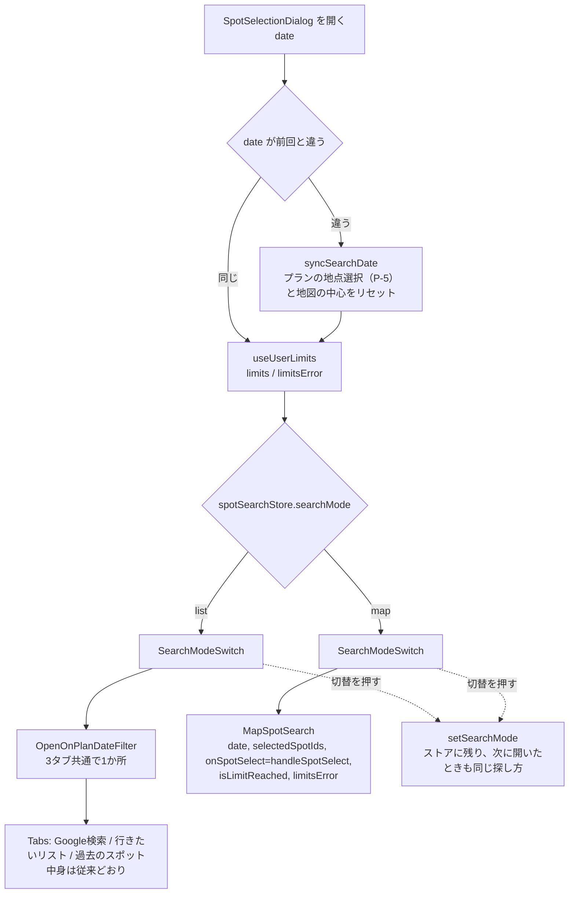
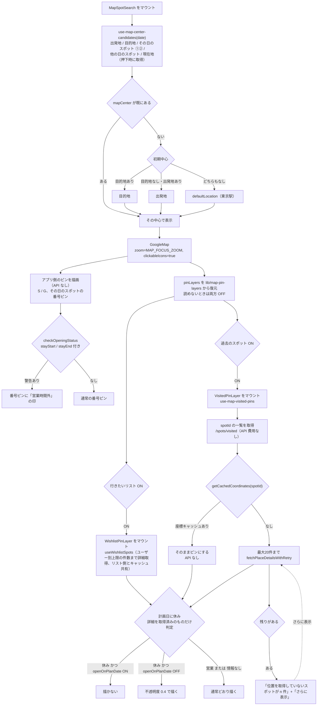
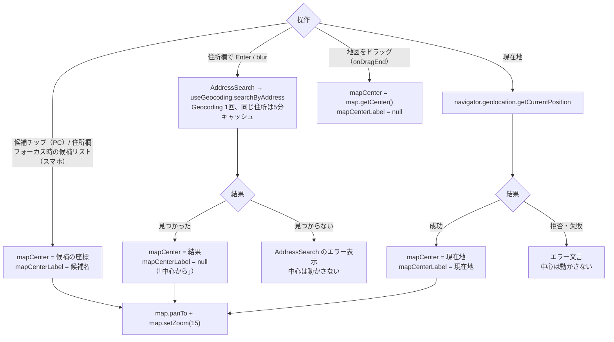
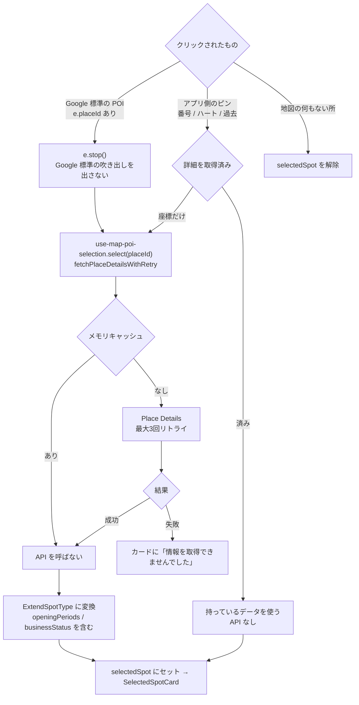
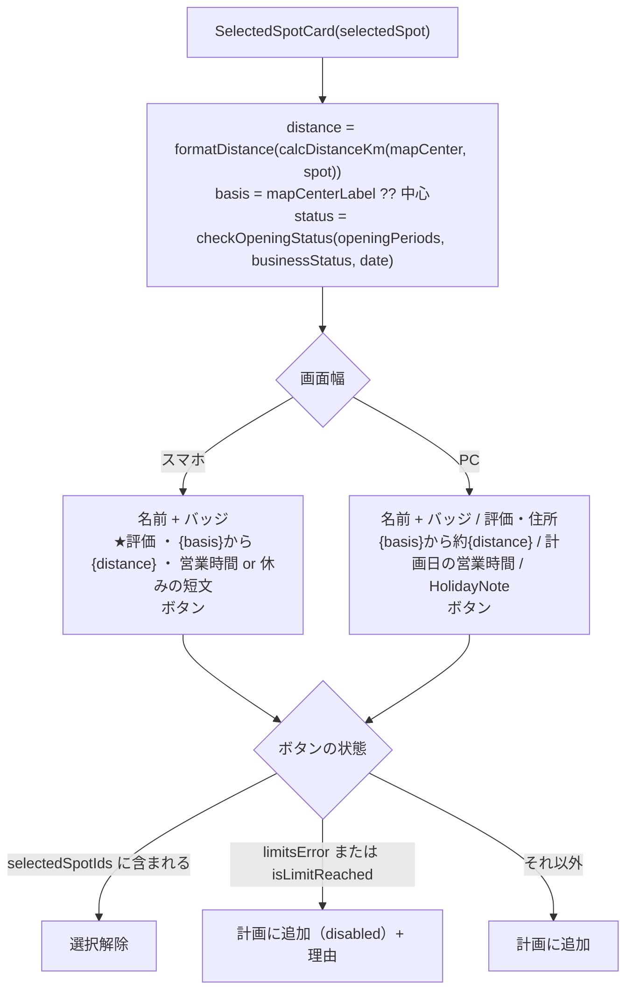
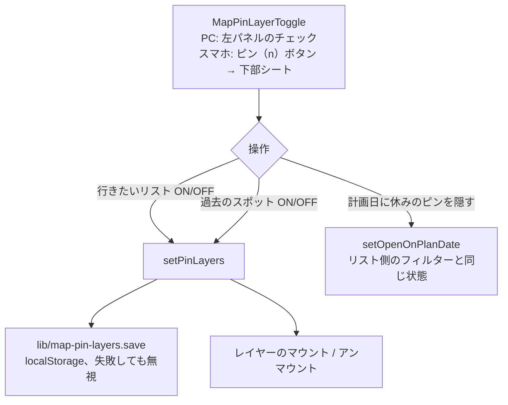

# No.341 地図からスポットを探す 処理フロー

実装後の処理の流れ。詳細は [No.341_実装計画.md](./No.341_実装計画.md) を参照。

## 1. ダイアログを開く

- 地図は `searchMode === 'map'` のときだけマウントされる。リストで探すのままなら地図は読み込まない。

## 2. 地図で探すの初期表示

## 3. 中心を移す

## 4. スポットを選ぶ

## 5. カードの表示

## 6. 追加・取り消し

```mermaid
sequenceDiagram
  actor U as 利用者
  participant Card as SelectedSpotCard
  participant Dialog as SpotSelectionDialog.handleSpotSelect
  participant Store as プランのストア
  participant Map as MapSpotSearch

  Note over Card: 描画時点で limitsError または isLimitReached なら<br/>ボタンは disabled で押せない（UI 側の制御）
  U->>Card: 計画に追加（ボタンが有効なときだけ）
  Card->>Dialog: onSpotSelect(setStartTimeAutomatically(spot, planSpots), false)
  Note over Dialog: 呼び出し時点の limitsError / isLimitReached で再確認する<br/>（上限の再取得はしない。描画後に別の操作で上限に達した場合などに働く）
  alt 呼び出し時点で上限取得失敗 または 上限到達
    Dialog-->>U: トーストで止める
  else 追加できる
    Dialog->>Store: setSpots(date, spot, false)
    opt 休み・閉業
      Dialog-->>U: 確認トースト（#158）
    end
    Store-->>Map: plans 更新
    Map-->>U: その位置に番号ピン
    Card-->>U: 追加しました + 取り消す（ダイアログは閉じない）
  end

  U->>Card: 取り消す / 選択解除
  Card->>Dialog: onSpotSelect(spot, true)
  Dialog->>Store: setSpots(date, spot, true)
  Store-->>Map: plans 更新
  Map-->>U: 番号ピンが消える
  Card-->>U: 計画に追加 に戻る
```

## 7. 表示するピンの切替

